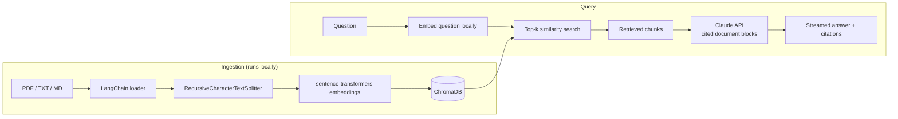

# RAG Document Q&A

[](LICENSE)


Ask questions about your own documents and get **grounded answers with citations** that trace every claim back to the exact passage it came from.

Built with **Python · LangChain · ChromaDB · FastAPI**, using Claude (Anthropic API) for generation and local `sentence-transformers` embeddings for retrieval.

## Features

- **Document ingestion** — upload PDF, TXT, or Markdown files; they are parsed, chunked, embedded, and stored in a persistent vector database.
- **Semantic retrieval** — questions are matched to document chunks by meaning (vector similarity), not keywords.
- **Grounded answers** — Claude answers *only* from the retrieved passages and says so when the documents don't contain the answer.
- **Native citations** — retrieved chunks are sent as cited document blocks via Claude's citations API, so each claim is structurally tied to its source text instead of relying on the model to self-report sources.
- **Streaming responses** — answers stream token-by-token over Server-Sent Events.
- **Local-first embeddings** — chunking and embedding run on your machine at no API cost.
- **Minimal web UI** — upload documents and chat from the browser.

## Architecture



1. **Ingest** — a file is loaded with LangChain, split into overlapping chunks, embedded locally, and persisted in ChromaDB.
2. **Retrieve** — the question is embedded with the same model and the top-k most similar chunks are fetched.
3. **Generate** — only those chunks are sent to Claude, which answers using solely that context and returns citations alongside the streamed text.

### Privacy model

The uploaded file, its chunks, the embeddings, and the vector index all stay on your machine. The only data sent to the Anthropic API is the text of the few chunks retrieved for a given question (default: 4 chunks of roughly 1,000 characters each) plus the question itself — never the full document or the original file.

## Project structure

```
rag-doc-qa/
├── app/
│   ├── main.py          # FastAPI app and endpoints
│   ├── config.py        # Settings loaded from .env
│   ├── ingestion.py     # Load, chunk, embed, and store documents
│   ├── retrieval.py     # Semantic similarity search
│   ├── rag_chain.py     # Claude call, streaming, citation extraction
│   ├── schemas.py       # Pydantic models
│   └── static/index.html  # Minimal chat UI
├── scripts/
│   └── ingest_cli.py    # Bulk-ingest a folder without running the server
├── data/uploads/        # Uploaded files (git-ignored)
├── requirements.txt
└── .env.example
```

## Getting started

### Prerequisites

- Python 3.10+ (developed and tested on 3.10; very new Python releases may lack prebuilt wheels for some dependencies such as ChromaDB and PyTorch)
- An [Anthropic API key](https://console.anthropic.com)

### Install

```bash
git clone https://github.com/Sanjaeyss/rag-doc-qa.git
cd rag-doc-qa

python -m venv .venv
source .venv/bin/activate
pip install -r requirements.txt

cp .env.example .env
# edit .env and set ANTHROPIC_API_KEY
```

### Run

```bash
uvicorn app.main:app --reload
```

Open [http://localhost:8000](http://localhost:8000), upload a document, and ask a question. The first ingestion downloads the embedding model (~90 MB).

### Ingest from the command line

```bash
python scripts/ingest_cli.py ./path/to/documents
```

## API

| Method | Endpoint | Description |
|---|---|---|
| `POST` | `/documents` | Multipart upload of one or more `.pdf`, `.txt`, `.md` files; returns chunk counts |
| `POST` | `/query` | Body `{"question": "...", "top_k": 4}`; returns a `text/event-stream` of `token`, `error`, and `done` events (`done` carries the citations) |
| `GET` | `/health` | Liveness check |

Example:

```bash
curl -N -X POST http://localhost:8000/query \
  -H "Content-Type: application/json" \
  -d '{"question": "What does the document say about X?"}'
```

## Configuration

Set in `.env` (see `.env.example`):

| Variable | Default | Description |
|---|---|---|
| `ANTHROPIC_API_KEY` | — | Required |
| `ANTHROPIC_MODEL` | `claude-sonnet-5-5` | Use `claude-opus-5-5` for higher-quality reasoning at higher cost |
| `EMBEDDING_MODEL` | `sentence-transformers/all-MiniLM-L6-v2` | Local embedding model |
| `CHUNK_SIZE` / `CHUNK_OVERLAP` | `1000` / `150` | Characters |
| `TOP_K` | `4` | Chunks retrieved per question |
| `CHROMA_PERSIST_DIR` | `./chroma_db` | Vector store location; delete the folder to reset the index |

## Roadmap

- Evaluation harness (e.g. [RAGAS](https://github.com/explodinggradients/ragas)) to measure retrieval relevance and answer faithfulness
- Cross-encoder reranking between retrieval and generation
- Multi-turn conversation history
- Docker Compose setup
- Document management (list and delete ingested files)

## License

Released under the [MIT License](LICENSE).
